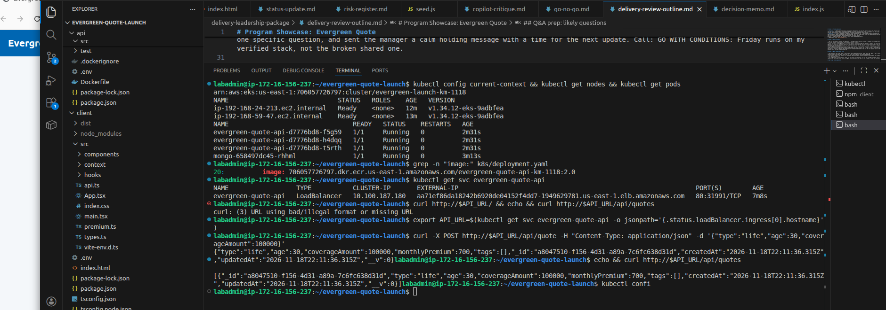

Cloud verification (Day 4 gated window, run Wed on my sandbox account). I ran the launch through one verified pass on Amazon EKS. I built a 2-node managed cluster with eksctl, pushed the same evergeen-quote-api:2.0 image that CI and my kind cluster had proven into Amazon ECR, and appliced the exact same manifests, with only a temp, uncommitted image-address change. Three API pods and a mongo pod reached running on EC2 machines, and the service received a real public load balancer address, which kind can't do. The API answered its health check over the public internet, and its database started empty, the same lesson as Wed, now in the cloud. A life quote saved through the public address returned $700 and came back in the list. The app code didn't change at all. I then tore everything down the same afternoon in the order the orchestration week taguth (workload, then cluster, then registry) and confirmed no clusters remained and kubectl was back on kind. 