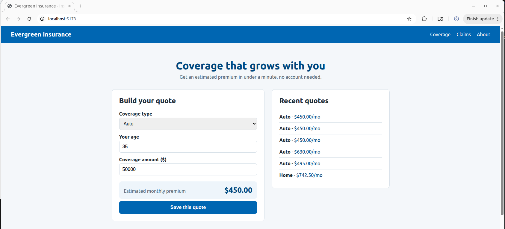

# Program Showcase: Evergreen Quote

> Copy to `delivery-leadership-package/delivery-review-outline.md`. Five slides OR one page. Target: 5 minutes spoken, then 3 minutes of questions. Your audience on Friday afternoon includes your managers; assume they have not seen the program from the inside.

## Slide 1: Delivery goal & did we hit it?

- Goal (one sentence): By Thursday EOD, the wired Evergreen Quote app saves quotes that survive a reload, the containerized API (2.0) has run as 3 replicas on the local cluster, and the launch is merged to main via a reviewed PR with both CI jobs green.

- Hit? X Yes  ☐ Partially  ☐ No
- One-line "why" either way. 
The website and the quote service now work together. A saved quote is still there after a reload, the service ran as 3 copies on a local cluster, and the launch merged to main with both automated checks green.

## Slide 2: What shipped

- A screenshot of the wired app: the quote page showing quotes that came from the database. 
- Link to the merged PR (the diff is the whole program in one page: HTML, TypeScript, JavaScript, a Dockerfile, YAML). https://github.com/asc1-student06/evergreen-quote-launch/pull/14
- Link to the green two-job CI run (API tests + client type-check and build).: https://github.com/asc1-student06/evergreen-quote-launch/actions/runs/44378671206

## Slide 3: Two key decisions

- **Decision 1:** Keep the instant price estimate in the browser, and make the server's price the official one. Once the halves were connected, the same quote showed $425 as an estimate and $450 once saved. I aligned the rates so customers see one price. I didn't rebuild how estimates work two days before launch; removing the duplicate rate table is planned for after launch.
- **Decision 2:** I split marketing's "lead with life" request into two. I approved the landing-page headline, which is content I own, and routed the form-default change to the team that owns the code. "It's one word" may be true, but something small to type isn't automatically small to ship. A launch-week change to shared code deserves its owners review. 
Decision 1 in decision memo and decision 2 is in status update and risk R5.
- (Both should be in `decision-memo.md`.)

## Slide 4: Risks & injects

- Top risk we tracked: The demo now depends on a running database, and the cluster's database starts empty (R1). Mitigation is a written demo plan, demo quoates saved ahead of time, and a screenshot fallback. 
- Inject #1 (Tue): Marketing wanted a life-first launch, renters coverage came back as a reuqest, and there would be no shared cloud for Friday. I approved the life-first headline, routed the form default to its owning team with the launch date, deferred renters (it now affects both validation systems and needs a sponsor-set rate), and confirmed the demo plan in writing: kind cluster 'evergreen', a port-forward on port 3000, and the app at localhost:5173.
- Inject #2 (Wed): A manager saw "Could not load recent quotes" on the "shared demo envt", where the API pods kept restarting after a variable rename. First I checked my own environment: 3 API pods plus mongo running, and a green CI. then I routed the evidence to the platform team with one specific question, and sent the manager a calm holding message with a time for the next update. Call: GO WITH CONDITIONS: Friday runs on my verified stack, not the broken shared one.

## Slide 5: What three phases built

- The journey in one slide: Phase 1 was a static page. Phase 2 was a live, typed React app. Phase 3 was a service with a database, packaged in a container and run on Kubernetes. This week all of it was wired into one product and merged.
- One sentence: what I take back to work on Monday: Before deciding anything, ask which environment the evidence came from, then send the problem to the person who owns it.
- One thing I'd do differently next round: Fix root cause at the source. The kit was missing its hidden config files in 2 phases in a row, and I rebuilt them both times. Next time I'd flag it to the instructor on Day 1 so the problem is fixed for everyone, not just for me.

## Q&A prep: likely questions

- "Why didn't you ship renters?" It now affects the website's rules and the database's rules, needs rates on both sides, and needs a price only the sponsor can set. I protected the launch and scheduled it for the next round.
- "Why not just change the form default? It's one word": It probably is one word. But it's in the code another team owns, and every estimate runs through it. I sent it to them with the laucnh date attached instead of slipping it in myself.
- "Why did the cluster show no quotes at first?" Its the same app in a new environment with a brand-new database. Settings travel with the deployment; data doesn't travel with the app.
- "A demo envt was down, why GO?" The broken environment was shared and owned by the platform team. Friday doesn't run on it, and my own cluster and CI were both green, so I could show evidence for my stack.
- "How did you use AI?" Copilot drafted two sample quotes. They passed every automated check and still weren't accurate: they used made-up prices that looked like real history. Passing the checks didn't make them true, so a person still has to review AI output.
- "What did the automated checks catch?" On Tues the type-checker caught a mismatch between the website and the service before any customer could hit it. The fix was one line.
